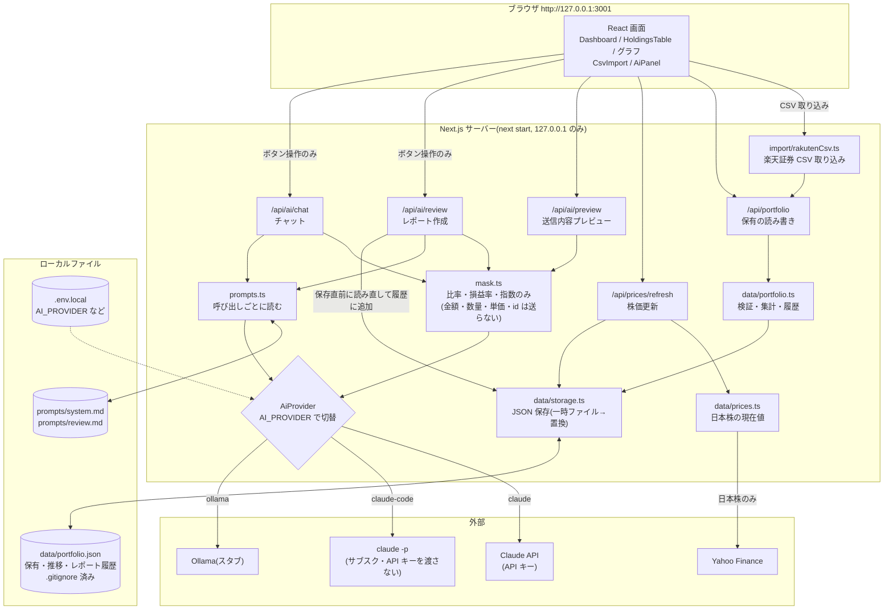
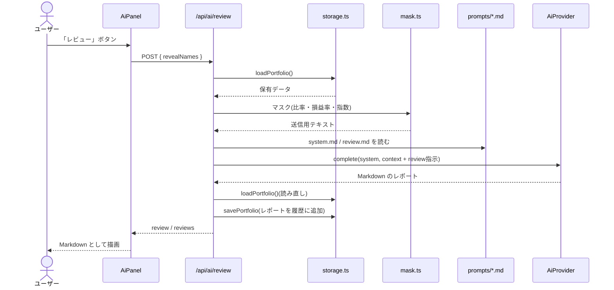

# 資産レビュー(portfolio)仕様

株式を中心とした個人資産を、ローカルで手動で見直すためのダッシュボード。使い方の手順は [README.md](../README.md) を参照。

## 1. 基本方針

| 項目 | 内容 |
|---|---|
| 実行環境 | ローカルのみ。`npm run dev` / `npm run start` は `127.0.0.1:3001` で待ち受け、他の PC からはアクセスできない |
| 起動 | `start-portfolio.bat`(ダブルクリック)。Node.js の確認 → 起動済みならブラウザを開くだけ → 初回は `npm install` → ビルドがないか、ビルド後に `src/` や設定ファイルが変わっていれば `npm run build` → `next start` をウィンドウなしで裏で起動(ログは `logs/`)→ 応答したらブラウザを開く(最大 60 秒待つ)。起動後、bat のウィンドウは閉じる。`PORTFOLIO_PORT` でポート、`PORTFOLIO_NO_BROWSER=1` でブラウザを開かない |
| 停止 | `stop-portfolio.bat`。ポートで待ち受けている node のプロセスだけを止める(ほかのプログラムが使っていれば止めない) |
| 実行タイミング | 価格更新・AI 呼び出しは**ボタン操作による手動実行のみ**。定期実行・画面表示時の自動実行はしない(AI が有料、またはサブスクの利用枠を使うため) |
| 外部への送信 | AI へはマスク済みデータ(比率・指数と銘柄名)だけを送る。金額・数量・単価・総資産額は送らない |
| 投資助言 | 行わない。AI には売買推奨・価格予想をさせない |

## 2. データ

### 2.1 保存先

- `portfolio/data/portfolio.json`(`.gitignore` 済み。コミットしない)
- 環境変数 `PORTFOLIO_DATA_PATH` で変更できる
- 書き込みは一時ファイルに書いてから置き換える(途中で壊れないように)
- JSON が壊れている場合は空データで上書きせず、読み込みエラーにする
- 読み込み時に1件ずつ検証し、不正な要素は捨てる

### 2.2 構造

```ts
interface PortfolioData {
  holdings: Holding[];   // 保有
  snapshots: Snapshot[]; // 日ごとの記録(日付の昇順)
  reviews: Review[];     // AI の見直しレポート(新しい順、最大 50 件)
}
```

| 型 | 主な項目 |
|---|---|
| `Holding` | `id`、`assetClass`、`code`(銘柄コード)、`name`、`sector`(業種・分類)、`quantity`、`costPrice`(取得単価)、`currentPrice`(現在値)、`priceUpdatedAt`、`source`(取り込み元。楽天証券なら `"rakuten"`、手入力は無し) |
| `Snapshot` | `date`(YYYY-MM-DD、日本時間)、`totalValue`、`totalCost`、`byClass`(資産クラス別の評価額) |
| `Review` | `createdAt`(ISO 8601)、`text` |

### 2.3 資産クラス

| 資産クラス | 入力 | 評価額 | 取得額 |
|---|---|---|---|
| 日本株(`jp_stock`) | 銘柄コード・株数・取得単価・現在値 | 株数 × 現在値 | 株数 × 取得単価 |
| 投資信託(`fund`) | 口数・取得単価・基準価額(いずれも1万口あたり) | 口数 × 基準価額 ÷ 10,000 | 口数 × 取得単価 ÷ 10,000 |
| 現金(`cash`) | 金額 | 金額 | 取得額(未入力なら金額と同じ) |
| その他(`other`) | 金額 | 金額 | 取得額(未入力なら金額と同じ) |

現金・その他は内部的に `quantity = 1`、`currentPrice` = 金額として持つ。現在値が 0(未取得)の銘柄は、一覧で「未取得」と表示する。

## 3. 画面

1 ページの 2 列構成(Claude Design で比較した C 案)。左に数字・グラフ・表、右に AI を置き、数字を見ながら AI に質問できるようにする。画面幅が狭いときは AI の列が下に回る。

- **ヘッダー**:保有件数と最終記録日。「CSV を取り込む」「保有を追加」「価格を更新して記録」のボタン
- **入力欄**(ヘッダーの下に開閉):「CSV を取り込む」で楽天証券の CSV 取り込み(4.2 節)、「保有を追加」や表の「編集」で保有の入力フォーム(資産クラスに応じて入力欄が変わる。現金・その他は金額だけ)
- **左の列**
  1. **要約**:総資産、評価損益(率と金額)、前回の記録からの増減(今日より前の最新の記録と比べる。記録がなければ「—」)
  2. **資産配分と推移**:資産クラス別のドーナツグラフと、評価額・取得額の折れ線グラフ(記録が 2 日分以上あるときに表示)
  3. **保有一覧**:評価額の大きい順。比率・損益(率と金額)・価格の更新日を表示。編集と削除(確認ダイアログあり)ができる
- **右の列**:AI による見直し(5 章)。レポートの作成、送信内容の確認、最新と過去のレポート、チャット

損益は緑(+)と赤(−)で示し、色だけに頼らないよう必ず符号を付ける。配色は `src/app/globals.css` の `@theme`、ボタンなど共通のスタイルは `src/components/ui.ts` にまとめている。

## 4. 機能

### 4.1 価格の更新(「価格を更新して記録」ボタン)

- **日本株だけ**、Yahoo Finance のチャート API(非公式)から現在値を取得する(`{コード}.T`)
- 取得に失敗した銘柄は前回の値のまま残し、画面に警告を出す
- 押した日のスナップショットを保存する。同じ日付は 1 件に上書きする
- 投資信託・現金・その他は対象外(手入力か CSV の再取り込みで更新する)

### 4.2 楽天証券の CSV 取り込み

**対象ファイル**:楽天証券の「保有商品一覧(すべて)」の CSV(`assetbalance(all)_*.csv`、Shift_JIS)

**流れ**:ファイルを選ぶ → 件数(資産クラス別)と警告を確認する → 「取り込む」で反映。ファイルはブラウザ内で読み、変換後の保有だけをサーバーに保存する。

**読み取り**

- 「■ 保有商品詳細」の見出し行(`種別`、`銘柄コード・ティッカー` …)を探し、列名で列を特定する(列の順番が変わっても読める)
- 明細は見出しの次の行から、空行または次のセクション(■)まで
- 円の預り金は明細に出ないため、前半の「■資産合計欄」の「預り金」行から取る

**変換**

| CSV の種別 | 取り込み先 | 使う値 |
|---|---|---|
| 国内株式 | 日本株 | 保有数量・平均取得価額・現在値(価格更新の対象になる) |
| 投資信託 | 投資信託 | 保有数量(口)・平均取得価額・現在値(1万口あたり) |
| 預り金・外貨預り金・楽天・マネーファンド | 現金 | 時価評価額[円] |
| 上記以外(米国株式など) | その他 | 時価評価額[円]。取得額 = 時価評価額 − 評価損益。分類に種別名を入れる |

**ルール**

- 同じ銘柄が複数の行(NISA と特定口座など)にあるときは、1 件にまとめる。数量は合計し、取得単価は数量で重み付けした平均にする
- 日本株・投資信託は「数量 × 現在値」を CSV の時価評価額と照合し、1% 以上ずれたら警告する
- 数値が読めない行は取り込まずに警告する
- 再取り込みでは、`source: "rakuten"` の保有だけを入れ替える。手入力の保有はそのまま残す
- 前回と同じ銘柄は、`id` と業種(CSV にない項目)を引き継ぐ
- 前回あって今回ない銘柄(売却済み)は消える
- 取り込み時にはスナップショットを記録しない(推移に反映するには続けて「価格を更新して記録」を押す)

## 5. AI による見直し

### 5.1 実行方法

`portfolio/.env.local` の `AI_PROVIDER` で切り替える。いずれも `AiProvider` インターフェース(`src/lib/ai/`)の実装。

| `AI_PROVIDER` | 費用 | 仕組み |
|---|---|---|
| `claude`(既定) | API の従量課金 | `ANTHROPIC_API_KEY` を使い、Anthropic SDK で直接呼ぶ |
| `claude-code` | サブスク(Pro/Max)の利用枠内 | Claude Code の CLI を `claude -p` で呼ぶ |
| `ollama` | 無料 | スタブ(未実装)。呼ぶと「未実装」のエラーを返す |

**共通**

- モデルは `claude-opus-5-5`
- effort はレポートが `high`、チャットが `medium`

**`claude`**

- サーバー側のフォールバック(`fallbacks: "default"`)を有効にし、安全上の理由で拒否された場合は別のモデルで再試行する
- 拒否された場合・空の応答はエラーにする。出力上限で途中で切れた場合は注記を付ける

**`claude-code`**

- CLI の場所は `CLAUDE_CODE_PATH` → VS Code 拡張に同梱の最新版 → PATH 上の `claude` の順に探す
- ツールはすべて無効(`--tools ""`)。セッションは保存しない(`--no-session-persistence`)。MCP は使わない
- 空の作業フォルダ(OS の一時フォルダ内)で実行し、リポジトリの CLAUDE.md などを読ませない
- 子プロセスには `ANTHROPIC_API_KEY` / `ANTHROPIC_AUTH_TOKEN` を渡さない(渡すと API 課金になるため)
- プロンプトは標準入力で渡す。会話履歴は 1 つのテキストにまとめる
- タイムアウトは 5 分

### 5.2 AI に送る内容(マスク)

実装は `src/lib/mask.ts`。「送信内容を確認」で、実際に送るテキストをそのまま表示できる。

| 区分 | 内容 |
|---|---|
| 送る | 基準日、保有数、全体の評価損益率、資産クラス別の比率、銘柄別の比率・損益率・資産クラス・業種、上位 1/3/5 銘柄の集中度、推移の指数(最初の記録の評価額 = 100 とした評価額と取得額) |
| 銘柄名・コード | 「銘柄名を送る」がオン(既定)のとき送る。オフなら「銘柄A」「銘柄B」…と業種だけにする |
| 送らない | 金額、株数・口数、単価、総資産額、`id` |

比率・損益率・指数は小数第 1 位に丸める。送信テキストに金額・数量・単価・`id` が含まれないことをテスト(`mask.test.ts`)で確認している。

### 5.3 AI への指示(システムプロンプト)

本文は `prompts/system.md`。レポートとチャットの両方で使う。

プロンプトは AI を呼ぶたびにファイルから読む(`src/lib/ai/prompts.ts` の `loadPrompts`)。そのため、編集して保存すればビルド・再起動なしで反映される。`<!-- -->` のコメントは取り除いて送る。ファイルがない・空・読めないときは、コードに組み込んだ既定(`SYSTEM_PROMPT` / `REVIEW_INSTRUCTION`)を使う。「送信内容を確認」で、使われるプロンプトとその読み込み元を表示する。

- **データの読み方**を説明する
  - 比率は現金を含む総資産に対する割合
  - 損益率は購入時点からの累計なので、銘柄間の値動きの比較には使わない
  - 「未取得」は集計から外れているだけで、売却済みではない
  - 基準日の損益率と推移の記録の差は、記録後の値動きによるもので、集計の誤りではない
  - 推移の取得額には現金を含むので、入金と値動きを区別できる
- 金額・取得時の比率を推測・逆算しない。匿名ラベルのときは資産クラスと業種だけで分析する
- 個別銘柄の売買推奨(利益確定・損切りを含む)・価格予想はしない。保有理由や目標配分を点検する問いの形にする
- データから言えることと一般論を区別し、一般論は「一般に」と明示する
- 同じ事実を繰り返さない。アプリの使い方の助言はしない。タイトルと表は付けない(狭い画面で読むため)

### 5.4 見直しレポート

- 「見直しレポートを作成」ボタンで作成する。指示は `prompts/review.md`。800〜1,000 字
- 構成
  1. 冒頭の1行:評価損益率と資産構成の全体像
  2. 今回のポイント:重要な順に3つ(事実と、なぜ重要か)
  3. 前回からの変化:直近の記録間の変化を2行で、入金・売買と値動きを区別する。記録が1件以下なら「比較できる記録がまだありません。」
  4. 配分・集中のリスク:最大3項目(データの事実1行+一般論1行)
  5. 個別の損益:個別株などの含み損と、±20% 以上の銘柄(該当がなければ省く)
  6. 次回までに確認すること:3〜4項目
- プロンプトは、架空データ2種類で5回の改善ループを回して決めた。変えるときは `src/lib/ai/reviewPrompt.eval.test.ts`(`PROMPT_OUT` を指定したときだけ動く評価用テスト。`PROMPT_DIR` で試したいプロンプトのフォルダを指定できる)で出力を見比べる
- 保存直前にデータを読み直し、AI の応答を待つ間の編集を上書きしない
- 履歴として保存する(新しい順、最大 50 件)。画面には最新のレポートを表示し、過去のレポートは折りたたんで表示する

### 5.5 チャット

- 保有状況(マスク済み)を前提に質問できる
- 会話は保存しない(画面を閉じると消える)
- 制限:最大 40 ターン、1 回の入力は 4,000 文字まで。user から始まって交互に並び、user で終わる形式だけを受け付ける
- 失敗したときは、質問を履歴から外して入力欄に戻す

## 6. API(Route Handler)

| メソッド・パス | 内容 |
|---|---|
| `GET /api/portfolio` | データ全体を返す |
| `PUT /api/portfolio` | 保有一覧を置き換える(`{ holdings }`)。1 件でも不正なら 400。記録・レポートはそのまま |
| `POST /api/prices/refresh` | 日本株の価格を更新し、今日のスナップショットを保存する。`{ data, errors }` を返す |
| `GET /api/ai/preview?revealNames=true\|false` | AI に送るテキストと送信先を返す |
| `POST /api/ai/review` | `{ revealNames }` でレポートを作成・保存する。`{ review, reviews }` を返す |
| `POST /api/ai/chat` | `{ revealNames, messages }` で回答を返す。`{ text }` |

AI の呼び出しに失敗したときは、利用者向けのメッセージ(API キー未設定、ログイン切れ、利用上限など)を 502 で返す。

## 7. 設定(`portfolio/.env.local`、`.gitignore` 済み)

| 変数 | 既定 | 内容 |
|---|---|---|
| `AI_PROVIDER` | `claude` | `claude` / `claude-code` / `ollama` |
| `ANTHROPIC_API_KEY` | なし | `claude` のときに必要 |
| `CLAUDE_CODE_PATH` | 自動検出 | `claude-code` のときの CLI のパス |
| `PORTFOLIO_DATA_PATH` | `data/portfolio.json` | 保存先 |
| `PORTFOLIO_PROMPTS_DIR` | `prompts/` | プロンプトのフォルダ |

## 8. 未対応・制約

- 投資信託の基準価額は自動で取得しない(手入力か CSV の再取り込みで更新)
- 米国株などの「その他」は、取り込んだ時点の円換算額で固定される(CSV の再取り込みで更新)
- 口座別(NISA / 特定)の内訳は持たない(1 銘柄 1 件にまとめる)
- 楽天証券以外の CSV には対応していない
- 株価の取得元は非公式 API のため、仕様変更で取得できなくなる可能性がある
- ローカル AI(Ollama)は未実装

## 9. 開発上のルール

詳細はリポジトリ直下の `CLAUDE.md` を参照。

- 保有データ・CSV(`portfolio/data/`)と `.env.local` はコミットしない
- 開発作業をする Claude は、ユーザーの実データをマスクした形でも読まない。動作確認は `PORTFOLIO_DATA_PATH` をスクラッチパッドに向け、架空データ(`src/lib/import/rakutenCsv.fixture.ts` など)だけで行う
- AI を自動で呼び出す仕組み(定期実行など)は追加しない
- AI に送る内容を変えるときは、`mask.test.ts` の「含まない」テストも更新する
- テストは PowerShell から実行する(Git Bash から `npx vitest` を実行すると失敗することがある)

## 10. システム構成

### 10.1 全体像



### 10.2 AI レビューの流れ



### 10.3 フォルダ構成

テスト(`*.test.ts(x)`)は対象のファイルと同じ場所に置く(一覧では省略)。直下の設定ファイルは、各ツール(Next.js・TypeScript・ESLint・Vitest・npm)がプロジェクトのルートから読むため、この階層に置く。

```text
portfolio/
├─ start-portfolio.bat / stop-portfolio.bat   裏で起動・停止(next start、ログは logs/)
├─ README.md                 使い方
├─ docs/
│  └─ SPEC.md                仕様(このファイル)
├─ prompts/                  AI へのプロンプト(呼び出しのたびに読む。ビルド不要で編集可)
│  ├─ system.md
│  └─ review.md
├─ data/                     保有データ・取り込んだ CSV(.gitignore 済み。コミットしない)
├─ logs/                     サーバーログ(.gitignore 済み)
├─ .env.local                AI_PROVIDER などの設定(.gitignore 済み)
├─ package.json / package-lock.json   依存とスクリプト
├─ next.config.ts            Next.js の設定
├─ tsconfig.json             TypeScript の設定(@ エイリアス = src/)
├─ eslint.config.mjs         ESLint の設定
├─ vitest.config.mts / vitest.setup.ts   テストの設定と前処理(taskboard と同じ配置)
├─ AGENTS.md                 Next.js 16 の注意書き(next dev が再生成する。消さない)
├─ .gitignore / .gitattributes
├─ next-env.d.ts             自動生成(.gitignore 済み。編集しない)
├─ tsconfig.tsbuildinfo      自動生成のキャッシュ(.gitignore 済み)
└─ src/
   ├─ app/                   App Router
   │  ├─ layout.tsx / page.tsx / globals.css / icon.svg
   │  └─ api/                Route Handler(6 章)
   │     ├─ portfolio/       保有の読み書き
   │     ├─ prices/refresh/  価格更新とスナップショット
   │     └─ ai/
   │        ├─ preview/      送信内容のプレビュー
   │        ├─ review/       見直しレポート
   │        └─ chat/         チャット
   ├─ components/            画面(クライアントコンポーネント)
   │  ├─ Dashboard.tsx       全体をまとめる
   │  ├─ HoldingsTable.tsx / HoldingForm.tsx
   │  ├─ AllocationChart.tsx / HistoryChart.tsx
   │  ├─ CsvImport.tsx       楽天証券 CSV の取り込み
   │  ├─ AiPanel.tsx         レポート・チャット
   │  ├─ Markdown.tsx        AI の回答を React 要素で描画
   │  ├─ AppIcon.tsx
   │  └─ ui.ts               共通のクラス(損益の色 pnlTextClass など)
   ├─ lib/
   │  ├─ mask.ts             AI に送るデータのマスク
   │  ├─ ai/                 AI 呼び出し
   │  │  ├─ index.ts         AI_PROVIDER による切り替え・文脈の組み立て
   │  │  ├─ claude.ts        Claude API(API キー)
   │  │  ├─ claudeCode.ts    claude -p(サブスク)
   │  │  ├─ ollama.ts        スタブ
   │  │  ├─ prompts.ts       prompts/*.md の読み込みと既定値
   │  │  └─ types.ts
   │  ├─ data/               保有データ
   │  │  ├─ portfolio.ts     検証・集計・スナップショット・履歴
   │  │  ├─ storage.ts       JSON ファイルへの保存
   │  │  └─ prices.ts        日本株の現在値の取得
   │  ├─ import/             CSV の取り込み
   │  │  ├─ csv.ts           CSV の解析
   │  │  ├─ rakutenCsv.ts    楽天証券 CSV の変換
   │  │  └─ rakutenCsv.fixture.ts  テスト用の架空データ
   │  └─ text/               表示用
   │     ├─ format.ts        円・%・日付の整形
   │     └─ markdown.ts      Markdown の解析
   └─ types/
      └─ portfolio.ts        データの型
```

### 10.4 設計の理由

一言でいうと、**自分の PC の中で完結する家計簿アプリ**。外に出ていくのは「株価の問い合わせ」と「金額を伏せたデータを AI に相談すること」の 2 つだけにしている。

```text
┌────────────── 自分の PC ──────────────┐
│                                        │
│   ① 画面(ブラウザ)                    │
│        見る・入力する・ボタンを押す     │
│              │                         │
│              ▼                         │
│   ② 裏方(サーバー)                    │
│        計算する・保存する・外とやりとり │
│              │                         │
│              ▼                         │
│   ③ ノート(data/portfolio.json)       │
│        保有銘柄・金額・過去のレポート   │
│                                        │
└──────────┬───────────────┬────────────┘
           │               │
     株価を聞く      金額を伏せて相談
           ▼               ▼
      Yahoo Finance      Claude(AI)
```

| 決めたこと | 理由 |
|---|---|
| 画面・裏方・ノートをすべて自分の PC に置く | 資産データは個人的な情報なので、クラウドに置かず、漏えいの心配をなくす。裏方はこの PC からしか開けない(`127.0.0.1`) |
| 保存は JSON ファイル 1 つにする | 1 人分のデータなら、データベースを使う必要がない。バックアップもファイルをコピーするだけで済む |
| 外とのやりとりは必ず裏方を通す | AI に送る前に、裏方が金額・数量・単価を必ず伏せる(`mask.ts`)。画面から直接は送らないので、伏せずに送る道ができない。API キーもブラウザに渡さない |
| AI はボタンを押したときだけ呼ぶ | 有料なので、知らないうちに料金がかからないようにする |
| AI の呼び出し方を切り替えられるようにする | API キー払い・サブスク(`claude -p`)・将来の PC 内 AI(Ollama)を、設定 1 行(`AI_PROVIDER`)で選べるようにする |
| AI への指示は `prompts/*.md` の文章ファイルにする | メモ帳で書き換えて保存すれば、次の回答から反映される。プログラムを作り直す必要がない |
| Next.js で画面と裏方を 1 つのプロジェクトにまとめる | 普通は別々に作る 2 つをまとめられるので、小さな個人用アプリに向く。隣の `taskboard/` と作り方をそろえられる |
| bat をダブルクリックして裏で起動する | 黒い画面を開いたままにしなくてよい。本番用の起動方法(`next start`)なので動作も軽い |

選ばなかったもの:

| 選ばなかったもの | 理由 |
|---|---|
| クラウドに置く(Vercel など) | 資産データが PC の外に出てしまう |
| データベース(SQLite など) | 1 人分なら JSON ファイルで足り、仕組みが増えるだけ |
| ブラウザから直接 AI を呼ぶ | API キーが見えてしまい、伏せずに送る道ができる |
| 証券会社と自動で連携する | 個人向けに使える API が少ないため、CSV の取り込みと手入力にした |
